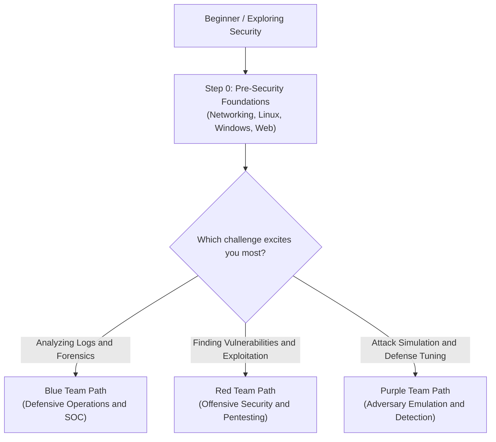
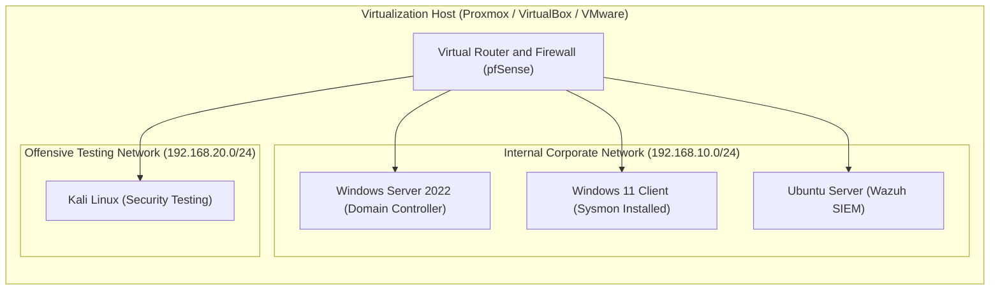

# 🛡️ Modern Cybersecurity Roadmap: Choose Your Journey

An end-to-end, hands-on roadmap designed for aspiring and transitioning security professionals. Whether your passion lies in stopping attacks, breaking modern defenses legally, or bridging the gap between both disciplines, this guide offers structured learning milestones, curated high-impact labs, and practical home-lab blueprints.

---

## 🧭 Navigation
- [🎯 Choose Your Path](#-choose-your-path)
- [🧩 Foundational Launchpad (Pre-Security)](#-foundational-launchpad-pre-security)
- [🔵 Blue Team Path: Defensive Security & SOC](#-blue-team-path-defensive-security--soc)
- [🔴 Red Team Path: Offensive Security & Pentesting](#-red-team-path-offensive-security--pentesting)
- [🟣 Purple Team Path: Collaborative Adversary Engineering](#-purple-team-path-collaborative-adversary-engineering)
- [🧪 Home Lab Blueprint](#-free--budget-home-lab-blueprint)
- [📜 Certification Reference Matrix](#-certification-reference-matrix)
- [🤝 Contributing](#-contributing)

---

## 🎯 Choose Your Path

Not sure where you belong? Here is a breakdown of the three primary paths based on personality traits, daily activities, and career objectives:

| Dimension | 🔵 Blue Team (Defensive) | 🔴 Red Team (Offensive) | 🟣 Purple Team (Collaborative) |
| :--- | :--- | :--- | :--- |
| **Primary Mission** | Defend networks, detect threats, and orchestrate incident response | Discover vulnerabilities, test security posture, and simulate real-world attacks | Bridge the gap between attack and defense; enhance overall security posture |
| **Ideal For You If** | You love problem-solving, triage, forensic investigations, and hunting adversaries | You enjoy creative problem-solving, breaking complex systems, and understanding exploit mechanics | You want the full picture, enjoy both attacking and building resilient detection engines |
| **Key Mindset** | *"How can I identify anomalous behavior and make this system impenetrable?"* | *"Where are the hidden design flaws and attack vectors in this architecture?"* | *"If an attacker uses technique X, what telemetry do we capture, and how do we alert on it?"* |
| **Core Tooling** | SIEM (Splunk, Wazuh), EDR, Wireshark, Zeek, Suricata, Memory/Disk Forensics | Burp Suite, Nmap, Metasploit, Impacket, BloodHound, Cobalt Strike | MITRE ATT&CK, Atomic Red Team, Sigma rules, Caldera, Sysmon |
| **Detailed Guide** | [Blue Team Deep Dive](paths/blue-team.md) | [Red Team Deep Dive](paths/red-team.md) | [Purple Team Deep Dive](paths/purple-team.md) |

---

## 🧩 Foundational Launchpad (Pre-Security)

> **Uncertain where to start?**
> Before committing to a specialized specialization, build fundamental digital literacy. These concepts apply universally across defense, offense, and purple teaming.

- **Foundational Track**:
  - [TryHackMe: Pre Security](https://tryhackme.com/path/outline/presecurity) — Comprehensive primer covering networking basics, web architecture, and fundamental operating system components.
  - [TryHackMe: Introduction to Cyber Security](https://tryhackme.com/path/outline/introtocyber) — Hands-on taste of defensive security, offensive security, and career trajectories.

---

## 🔵 Blue Team Path: Defensive Security & SOC

Defensive security focuses on maintaining organizational resilience, monitoring infrastructure for anomalies, and performing swift forensic triage when breaches occur.

### Step 1: Operating System Fundamentals
Master the systems you are responsible for monitoring and defending:
- [THM: Windows Fundamentals 1](https://tryhackme.com/room/windowsfundamentals1xbx) — Desktop environment, settings, file systems, and registry basics.
- [THM: Windows Fundamentals 2](https://tryhackme.com/room/windowsfundamentals2x0x) — Task Scheduler, Event Viewer, Services, and System Configuration.
- [THM: Windows Fundamentals 3](https://tryhackme.com/room/windowsfundamentals3xzx) — Windows Updates, Security Policies, Firewall, and Defender controls.
- [HTB Academy: Linux Fundamentals](https://academy.hackthebox.com/module/details/18) — Terminal navigation, user permissions, process lifecycle, and log files.

### Step 2: Networks & Systems Infrastructure
You cannot protect what you do not understand. Deepen your grasp of traffic flow and perimeter design:
- [HTB Academy: Intro to Networking](https://academy.hackthebox.com/module/details/34) — OSI model, TCP/IP, subnetting, ARP, DNS, DHCP, and standard routing.
- [THM: Cyber Defense 101](https://tryhackme.com/path/outline/cybersecurity101) — Core networking models, common threats, cryptography fundamentals, and security controls.
- [Cisco Networking Academy & Packet Tracer](https://www.netacad.com/courses/packet-tracer) — Build, configure, and troubleshoot virtual enterprise network topologies.

### Step 3: Detection, Telemetry & Analysis
Move inside the Security Operations Center (SOC) to detect real-world adversary behavior:
- [THM: SOC Level 1 Path](https://tryhackme.com/path/outline/soclevel1) — Cyber Defense Frameworks (Cyber Kill Chain, MITRE ATT&CK), SIEM monitoring (Splunk, Elastic), and Endpoint Investigation (Sysinternals, Zeek, Suricata).
- [CyberDefenders: Network Forensics Challenges](https://cyberdefenders.org/blueteam-ctf-challenges/?categories=network-forensics) — Analyze packet captures (PCAPs), dissect malware traffic, and extract Indicators of Compromise (IOCs).

### Step 4: Web Application Threats (The Blue Perspective)
Learn how web vulnerabilities manifest in server logs and traffic streams:
- [OWASP Top 10](https://owasp.org/www-project-top-ten/) — Study the critical risk categories (Broken Access Control, Cryptographic Failures, Injections) to implement defenses.
- [PortSwigger Web Security Academy](https://portswigger.net/web-security) — Free, gold-standard curriculum covering web security mechanics, input validation, and secure headers.

### Step 5: Active Directory Defense & Hardening
Active Directory (AD) is the identity backbone for over 90% of Global Fortune 1000 enterprises:
- [THM: Active Directory Basics](https://tryhackme.com/room/activedirectorybasics) — Domain Controllers, forests, group policies, Kerberos authentication, and organizational units.
- **Key Defensive Concepts**: Implement Tiered Administration models, monitor Event IDs (4624, 4672, 4768, 4769), and deploy auditing on sensitive groups.

👉 *Explore the complete roadmap: [paths/blue-team.md](paths/blue-team.md)*

---

## 🔴 Red Team Path: Offensive Security & Pentesting

Offensive security uses adversarial techniques within an authorized scope to validate an organization's security posture and uncover exploitable flaws before threat actors do.

### Step 1: System & Command-Line Foundations
An offensive practitioner must be fluent in scripting and terminal environments:
- [THM: Pre Security](https://tryhackme.com/path/outline/presecurity) — Foundational system mechanics.
- [HTB Academy: Linux Fundamentals](https://academy.hackthebox.com/module/details/18) — Shell commands, pipe operators, user pivoting, and bash scripting.
- [THM: Windows Fundamentals 1](https://tryhackme.com/room/windowsfundamentals1xbx), [Part 2](https://tryhackme.com/room/windowsfundamentals2x0x), & [Part 3](https://tryhackme.com/room/windowsfundamentals3xzx) — Command-line administration, registry keys, and local privilege constructs.

### Step 2: Networks & Infrastructure Mapping
Learn to visualize target networks from packet-level interactions:
- [HTB Academy: Intro to Networking](https://academy.hackthebox.com/module/details/34) — Routing protocols, port addressing, NAT, and network segmentation.
- [Cisco Networking Academy & Packet Tracer](https://www.netacad.com/courses/packet-tracer) — Understand enterprise layouts, firewalls, and switching fabric before learning how to bypass them.

### Step 3: Penetration Testing Fundamentals
Transition from theory into practical exploitation frameworks:
- [THM: Jr Penetration Tester Path](https://tryhackme.com/path/outline/jrpenetrationtester) — Penetration testing methodologies, vulnerability discovery, Metasploit, Nmap, and privilege escalation.
- [HTB Academy: Getting Started](https://academy.hackthebox.com/) — Foundational hands-on labs introducing target enumeration and practical flag capture.
- [VulnHub: Offline Vulnerable Machines](https://www.vulnhub.com/) — Downloadable standalone target VMs for offline experimentation and CTF practice.

### Step 4: Web Application Exploitation
Web applications remain the most accessible attack surface:
- [PortSwigger Web Security Academy](https://portswigger.net/web-security) — Master SQLi, Cross-Site Scripting (XSS), Server-Side Request Forgery (SSRF), IDOR, and authentication flaws with interactive labs.
- [OWASP Top 10](https://owasp.org/www-project-top-ten/) — Review the top attack vectors and learn how to construct reproducible proof-of-concept exploits.

### Step 5: Active Directory Attack Vectors
Enterprises operate on domain environments. Gaining domain dominance is a primary objective:
- [THM: Active Directory Basics](https://tryhackme.com/room/activedirectorybasics) — Protocol overview, user rights, and authentication flows.
- [HTB Academy: Active Directory Enumeration & Attacks](https://academy.hackthebox.com/module/details/143) — Hands-on execution of Kerberoasting, AS-REP Roasting, Pass-the-Hash, BloodHound path mapping, and ACL abuse.

### Step 6: Vulnerability Coordination & Bug Bounty
Apply your technical capabilities ethically on real targets with monetary rewards:
- **Major Bounty Platforms**:
  - [HackerOne](https://hackerone.com/) | [Bugcrowd](https://bugcrowd.com/) | [Intigriti](https://intigriti.com/) | [YesWeHack](https://yeswehack.com/) | [Synack](https://synack.com/)
- **Specialized Web Practice**:
  - [PentesterLab](https://pentesterlab.com/) — Highly structured bite-sized exercises targeting web vulnerabilities from discovery to scriptable exploitation.

👉 *Explore the complete roadmap: [paths/red-team.md](paths/red-team.md)*

---

## 🟣 Purple Team Path: Collaborative Adversary Engineering

Purple teaming is not a permanent separate team; it is an active collaborative culture and engineering practice. It ensures offensive exercises directly improve detection engineering and threat mitigation.

### Step 1: Unified Dual Foundations
A proficient purple team practitioner must possess the core skills of both roles:
- Complete **Blue Team Steps 1–2** *(OS + Networking & Systems)*
- Complete **Red Team Steps 1–2** *(Terminal proficiency + Network Mapping)*

### Step 2: Correlated Offense and Defense Practice
Study both perspectives simultaneously:
- [THM: Jr Penetration Tester](https://tryhackme.com/path/outline/jrpenetrationtester) — Learn how modern attacks are sequenced.
- [THM: SOC Level 1](https://tryhackme.com/path/outline/soclevel1) — Examine the forensic artifacts and alert alerts generated by those attacks.
- [PortSwigger Web Security Academy](https://portswigger.net/web-security) — Execute web exploit techniques while observing access logs and Web Application Firewall (WAF) rule hits.
- [OWASP Top 10](https://owasp.org/www-project-top-ten/) — Align both offensive payloads and defensive input validation.

### Step 3: Detection Engineering & Adversary Emulation
Elevate from ad-hoc testing to systematic coverage:
- **MITRE ATT&CK Matrix Mapping**: Map known threat actor tactics, techniques, and procedures (TTPs) against your organization's detection posture.
- **Automated Emulation Tools**:
  - [Atomic Red Team](https://github.com/redcanaryco/atomic-red-team) — Scripted, unit-test-style attack execution mapped directly to ATT&CK techniques.
  - [MITRE Caldera](https://github.com/mitre/caldera) — Automated adversary emulation platform for continuous validation.
- **Rule Development**: Author vendor-neutral detection logic using [Sigma Rules](https://github.com/SigmaHQ/sigma) and convert them to target SIEM query formats.

> 💡 **The Core Purple Team Habit**:
> After reproducing any attack technique, always ask:
> 1. *"Did our endpoint detection capture this execution?"*
> 2. *"Did our SIEM correlate these events into a high-fidelity alert?"*
> 3. *"What noise or false positives does this rule generate in a production baseline?"*

👉 *Explore the complete roadmap: [paths/purple-team.md](paths/purple-team.md)*

---

## 🧪 Free / Budget Home Lab Blueprint

Practicing in pre-built browser environments is a great start, but building your own local lab provides hands-on infrastructure experience that sets you apart in interviews:

See [labs/home-lab-guide.md](labs/home-lab-guide.md) for full configuration walkthroughs, free evaluation ISOs, and script templates.

---

## 📜 Certification Reference Matrix

Certifications validate knowledge, but hands-on skill is what matters most. Here is how popular industry credentials align with each path:

| Level | 🔵 Blue Team Track | 🔴 Red Team Track | 🟣 Purple / Dual Track |
| :--- | :--- | :--- | :--- |
| **Entry / Associate** | CompTIA Security+, Microsoft SC-200 | eJPTv2 (eLearnSecurity), CompTIA PenTest+ | BTL1 (Blue Team Level 1) |
| **Intermediate** | BTL1, HTB Certified Defensive Security Analyst (CDSA) | TCM Security PNPT, OffSec OSCP | GIAC GCIH, CyberDefenders CCD |
| **Advanced / Specialist** | BTL2, SANS SEC504 / SEC508 (GCFA) | OffSec OSEP, Altered Security CRTO | SANS SEC599, OffSec OSDA |

---

## 🤝 Contributing

We welcome additions, link updates, and new lab recommendations from the community!
- Check out [CONTRIBUTING.md](CONTRIBUTING.md) to get started.
- Review our [Cheatsheets & Quick Reference](resources/cheatsheets.md).

---

## 📄 License

This repository is distributed under the [MIT License](LICENSE). Feel free to share, adapt, and build upon it!
