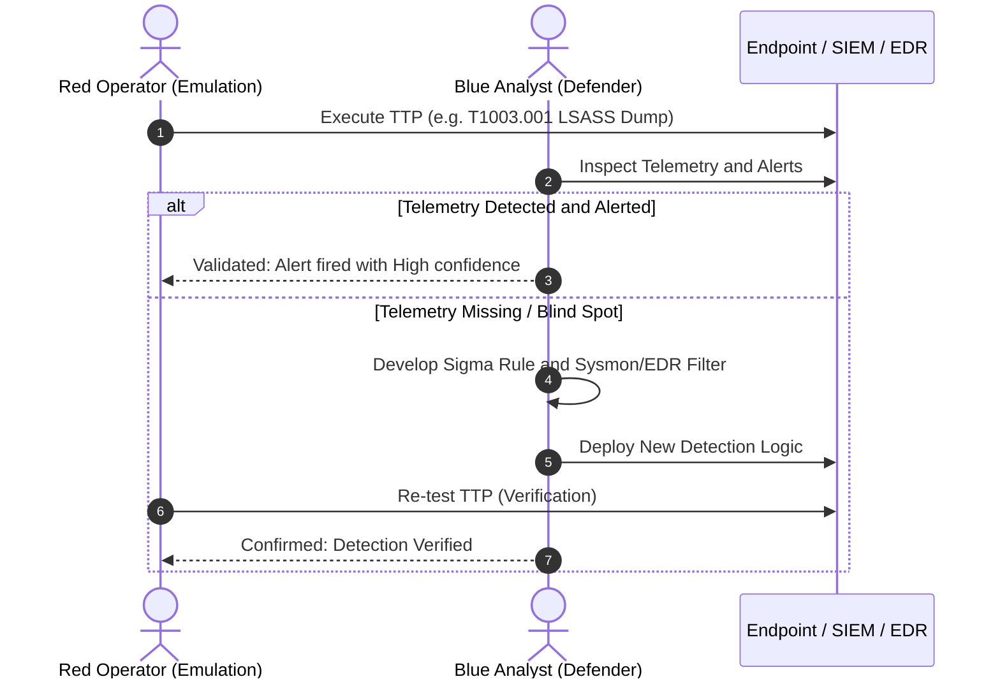

# 🟣 Purple Team Guide: Collaborative Adversary Engineering

Purple Teaming represents the convergence of offensive tactics and defensive telemetry. Rather than operating in silos, Red and Blue work together in real-time or automated loops to validate security controls and eradicate detection gaps.

---

## 🔄 The Purple Teaming Feedback Loop



---

## 🗺️ Key Purple Team Focus Areas

### 1. Framework Alignment: MITRE ATT&CK®
- **Tactics**: The "Why" of an attack (e.g., Initial Access, Persistence, Defense Evasion, Exfiltration).
- **Techniques & Sub-techniques**: The "How" (e.g., T1059.001 PowerShell, T1053.005 Scheduled Task).
- **Procedure Examples**: Real-world implementations by known Advanced Persistent Threats (APTs).
- **Coverage Mapping**: Using [MITRE ATT&CK Navigator](https://mitre-attack.github.io/attack-navigator/) to color-code detected vs. undetected techniques across your enterprise.

### 2. Adversary Emulation Frameworks
- **[Atomic Red Team](https://github.com/redcanaryco/atomic-red-team)**:
  - Library of simple, open-source tests mapped directly to the MITRE ATT&CK matrix.
  - Executable in seconds via PowerShell (`Invoke-AtomicTest`) or terminal without needing a complex C2 server.
- **[MITRE Caldera](https://github.com/mitre/caldera)**:
  - Automated adversary emulation platform with multi-agent orchestration and automated execution graphs.

### 3. Detection Engineering: The Sigma Standard
Write detection logic once, convert and deploy everywhere:
- **What is Sigma?**: A generic, open signature format for log events (analogous to Snort for network traffic or YARA for file analysis).
- **Sample Sigma Rule Structure**:
```yaml
title: Suspicious PowerShell Encoded Command Execution
id: 5a8e23f9-67d1-4f05-82e7-814d33a6f1d2
status: experimental
description: Detects execution of PowerShell with base64 encoded parameters commonly used for obfuscation.
logsource:
    category: process_creation
    product: windows
detection:
    selection:
        Image|endswith:
            - '\powershell.exe'
            - '\pwsh.exe'
        CommandLine|contains:
            - ' -e '
            - ' -enc '
            - ' -encodedcommand '
    condition: selection
falsepositives:
    - Legitimate administrative orchestration scripts
level: medium
```
- Tools: Convert Sigma rules to Splunk SPL, Elastic DSL, or Azure Sentinel KQL using `sigma-cli` / `pySigma`.

---

## 🧠 The Purple Mindset in Practice

When executing any offensive technique, document:
1. **Execution**: Exact command executed, timestamp, user context, host identity.
2. **Expected Telemetry**: What Event IDs or system calls should have been produced? (e.g., Windows Event ID 4688, Sysmon ID 1 for process creation).
3. **Observed Telemetry**: Was the event logged on the local host? Did the forwarder deliver it to the SIEM?
4. **Alert Generation**: Did the SIEM correlation rule trigger? What was the alert priority?
5. **Mitigation / Tuning**: If missed, what rule or telemetry config closes this visibility gap without creating alert fatigue?

---

## 🎯 Recommended Next Steps
1. Install [Atomic Red Team](https://github.com/redcanaryco/atomic-red-team) in a test VM.
2. Execute an atomic test (e.g., `Invoke-AtomicTest T1087.001` - Local Account Discovery).
3. Review your Windows Event Viewer or Sysmon log to see if the command was recorded.
4. Draft a Sigma rule matching the activity.
