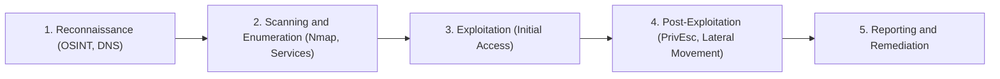

# 🔴 Red Team Guide: Offensive Security & Penetration Testing

Offensive security professionals simulate adversary behavior to evaluate an organization's detection posture, identify security gaps, and help fortify defenses.

---

## 🎯 Core Roles in Offense
- **Penetration Tester**: Authorized vulnerability assessment of web applications, networks, and internal infrastructure within defined scopes.
- **Red Team Operator**: Objective-based adversary simulations testing people, processes, and technology (evasion, stealth, persistence).
- **Vulnerability Researcher / Exploit Developer**: Discovering 0-day/n-day vulnerabilities and crafting weaponized payloads.
- **Bug Bounty Hunter**: Freelance security testing across public and private vulnerability disclosure programs.

---

## 🔄 The Penetration Testing Lifecycle

---

## 🗺️ Step-by-Step Learning Progression

### Phase 1: Offensive Shell Craft & Protocol Mastery
- Command line fluency in Bash and PowerShell:
  - Automating reconnaissance with one-liners (`awk`, `sed`, `grep`, `jq`, `curl`).
  - Native Windows Living-off-the-Land Binaries (LOLBINs) like `certutil.exe`, `bitsadmin.exe`, `powershell.exe`.
- Network pivoting basics:
  - SSH dynamic port forwarding (`ssh -D 1080`).
  - Chisel, Ligolo-ng, and Proxychains for pivoting into isolated subnets.

### Phase 2: Web Application Pentesting
- **Methodology**: Follow the OWASP Web Security Testing Guide (WSTG).
- **Critical Vulnerability Classes**:
  - SQL Injection (Error-based, Blind, Time-based, Out-of-Band).
  - Cross-Site Scripting (Reflected, Stored, DOM-based).
  - Broken Object Level Authorization (BOLA/IDOR) in REST APIs.
  - Server-Side Request Forgery (SSRF) hitting cloud metadata services (`169.254.169.254`).
  - File Upload bypasses (extension tricks, content-type spoofing, path traversal).
- **Primary Tool**: [Burp Suite Community / Professional](https://portswigger.net/burp) — Intercepting proxy, Repeater, Intruder, Match & Replace.

### Phase 3: Active Directory Enumeration & Exploitation
- **Reconnaissance**:
  - Querying domain objects without elevated privileges using LDAP queries, PowerView, or BloodHound.
- **Credential Access**:
  - **Kerberoasting**: Requesting service tickets for Service Principal Names (SPNs) and cracking ticket hashes offline via Hashcat.
  - **AS-REP Roasting**: Requesting authentication tickets for accounts without pre-authentication required.
  - **DCSync Attack**: Simulating replication requests via `secretsdump.py` to extract all domain NTLM hashes.
- **Lateral Movement**:
  - Pass-the-Hash (PtH) and Overpass-the-Hash with Impacket tools (`psexec.py`, `wmiexec.py`).
  - Windows Remote Management (WinRM) through `evil-winrm`.

### Phase 4: Bug Bounty Methodology
1. **Target Selection**:
   - Start with wide-scope programs offering swag or reputation points on HackerOne/Bugcrowd to build confidence without intense competition.
2. **Recon Automation**:
   - Subdomain enumeration: `subfinder`, `amass`, `httpx`.
   - Content discovery: `ffuf`, `feroxbuster`, `gau`, `waybackurls`.
3. **Report Quality**:
   - Write clear, reproducible, step-by-step reproduction steps with risk impact assessments.

---

## 🧰 The Red Team Toolkit
| Category | Standard Industry Tools | Usage |
| :--- | :--- | :--- |
| **Reconnaissance** | Amass, Subfinder, Nmap, Rustscan | Asset discovery and port scanning |
| **Web Proxy** | Burp Suite, Caido, OWASP ZAP | HTTP/WebSocket manipulation |
| **Exploitation Frameworks** | Metasploit, Searchsploit | Proof-of-concept testing |
| **AD & Lateral Movement** | BloodHound, Impacket, Evil-WinRM, Mimikatz | AD path graphing, credential dumping |
| **Password Cracking** | Hashcat, John the Ripper | GPU-accelerated hash recovery |

---

## 🎯 Recommended Next Steps
1. Complete [THM: Jr Penetration Tester](https://tryhackme.com/path/outline/jrpenetrationtester).
2. Complete [HTB Academy: Active Directory Enumeration & Attacks](https://academy.hackthebox.com/module/details/143).
3. Practice web vulnerabilities on [PortSwigger Web Security Academy](https://portswigger.net/web-security).
